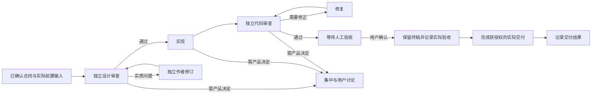

# 长程项目自主推进

## 摘要

本设计定义由主控协调、按阶段委派的长程项目推进方式。用户确认需求和初版设计后，主控在指定范围内组织设计审查、实现、独立代码审查与必要修复，直到需要人工验收、实际交付或用户决定。主控根据当前项目文档、源码和真实结果判断进展，直接维护原处的正式文档与元数据，完成更新后提交并推送项目分支。阶段执行者对分配的工作负责，用户保留需求、接口、兼容性、关键约束和验收标准的决定权。

项目记录表达实际事实。设计和代码审查保留真实作者、独立审查者与目标；人工验收和源码交付分别记录。项目文件发布不代表代码交付、外部系统同步或线上行为已验证。

## 背景

长程项目包含相互依赖的工作项，逐项人工调度会让用户反复推动阶段；所有工作交给同一执行者，又容易混淆作者、审查者、验收和交付。任务恢复时还需要分辨已经完成的代码、仍适用的证据与真正缺少的输入，避免重复实施或丢失用户决策。

项目的当前需求、设计、依赖、状态和证据保存在现有文件中，Git 保存历史版本。主控直接读取和维护这些文件，使用户能够随时检查和修改内容；阶段组织通过实际任务与报告完成。缺少事实时报告缺口，已有事实则直接复用，文件更新由当前任务授权和实际内容决定。

成功时，每个推进中的工作项具有明确的当前工作、输入合同、执行者和产物；审查基于真实目标独立作出；用户能够阅读并定稿代码和设计。遇到缺失依赖、实质合同变化或不可用执行能力时保留现场，只暂停受影响工作。摘要、重试次数和 AI 审查结果均不能替代真实验收与交付。

## 设计终态

### 组织与职责

主控从管理项目根目录组织工作，负责范围、阶段选择、一级执行者、正式项目记录、用户沟通和本轮收尾。主控直接维护文档及元数据并发布项目更新，不设置常驻工作项经理或额外管理层。一级执行者只负责一个工作项的一次阶段，返回结果后由主控选择下一阶段。主控核对和整合实际结果，不冒充作者或补造缺失的独立评审。

一次完成一个阶段及其后代任务，再记录结果并选择下一阶段。当前阶段因具体原因不能继续时保留工件，主控可以推进范围内其他具备实际输入的工作。阶段执行者自行组织其授权范围内的调查、验证和结果整合，并完成后代任务及资源收尾。

| 角色 | 职责 |
| --- | --- |
| 设计审查者 | 使用 `review-design` 对完整合同和一手证据形成独立结论 |
| 设计修订者 | 使用 `explore-design` 修正实质设计问题并说明合同变化 |
| 实现者 | 使用 `implement-design` 实现批准的合同并执行有意义的验证 |
| 代码审查者 | 使用 `review-implementation` 独立评估完整实现目标 |
| 修复者 | 使用 `receiving-code-review` 核验反馈并修正有依据的问题 |

主控采用调用方为一级角色提供的配置，不按工作难度自行改变固定角色配置。后代任务在自身职责和实际能力范围内组织，不继承主控职责。执行能力的配置存在不等于实际调用成功；记录实际执行事实，不推断未观察到的模型或工具身份。

### 范围与依赖

用户可以指定全项目、一个工作项及其子项，或若干明确工作项。层级表达组织，依赖表达真实交付前提。检查范围外的依赖不会扩大推进授权。主控在阶段完成、输入变化和用户决策后，依据当前文件及实际证据重新判断后续工作。

自主推进以已经确认的初版合同为输入。未明确的产品决定由用户确认，执行者不借推进授权补造批准。实现依赖真实可用的前置行为与声明的交付；设计可以保留明确的前提假设，待前置行为可核实时评估其适用性。缺失输入只影响依赖它的工作。

对于过大的工作项，先形成完整整体设计、可交付阶段、验收覆盖和依赖关系，再依独立审查结果拆分。子项继承完整相关合同，不因拆分而要求重复探索；真实缺口才需要补充设计。父项保持整体验收责任，不能用未来子项细化代替当前必须解决的设计选择。

### 阶段与独立审查

设计首次接受完整独立审查。后续审查检查变化、关联影响与未解决问题，并保留仍有效的覆盖。合同、接口、保证、验收标准或关键依赖假设改变时，审查受影响范围；只有影响无法界定或原覆盖广泛失效时，才扩大为完整复审。等价文档整理及不改变合同的实现修正不自动引起完整设计重审。

设计审查者默认只读。原批准合同或一手证据能唯一确定改法、无需新的设计选择且不改变行为与保证的机械错误，可以在授权候选中直接修正；记录精确差异、依据和合同不变，并审查最终候选。这种纠错不构成实质作者身份。缺失设计选择不能作为机械错误处理。实质问题交由另一位作者修正，再优先由仍独立的原审查者复审。作者身份跨实质修订保留，不能因为后来有人修改就恢复独立资格。

代码审查采用 `single-agent` 模式，包括复审。一位独立于实现及修复的合格审查者负责正确性、质量、安全、测试和高风险边界。实现者可以完成修复，结果仍由独立审查者核验。缺少必要能力或证据时报告无法完成的评估，不登记虚构的通过。非阻塞意见可以与真实通过结论并存。

### 直接维护项目文件

主控直接修改项目中现有的需求、设计、上下文、状态、依赖和证据文件。文档在最终路径维护，相关元数据随同更新，保持 ID、引用、实际源码位置和当前事实一致。用户的无关本地修改保持原样。完成一组连贯更新后，只提交相关项目文件并普通推送到配置的项目分支；提交或推送失败时保留现场和已有本地提交，解决实际错误后继续。

阶段执行者读取完整原始合同、项目及源码指令和一手证据，写入范围限于指定源码、候选工件或报告。正式项目记录由主控整合发布。报告包含真实执行者、工作项、阶段、目标、结论、输出路径、验证结果和未决事项；大型日志与中间资料保留在可访问的临时位置，不充当另一份正式项目文档。

项目记录提交与源码提交分别处理。普通自动推进将源码保留供用户验收；源码提交、推送、PR、部署及其他外部操作遵循覆盖该动作的实际授权。外部系统同步记录实际调用和结果，不能用项目 Git 推送成功代替同步成功。

### 证据与恢复

记录区分登记人、设计作者、实现者、修复者、独立审查者及用户。审查结论说明实际审查的合同和代码目标，包括未提交代码。复用覆盖时保留原审查的作者独立性、输入、已检查差异和当前适用范围。已有真实独立结论可以经适用性判断继续使用；这不是新的独立评审。实质合同变化、更新的失败结论或未解决决定，不能被历史通过覆盖。

主控阅读实际输入并判断证据能证明什么，不依靠登记动作本身证明质量。迟到报告只有在仍适用于当前目标时才可整合，不能覆盖更新版本的事实。任务恢复从现有文件、源码和报告继续，保留已完成工作，仅重做被变化实际影响的部分。不要因为一次失败而丢弃未发布代码、重建已有实现或扩大清理范围。

### 用户决策与真实权限

用户启动自主推进，授权主控在指定范围持续组织所需阶段，不必逐阶段再次询问。合同内的内部实现、私有类型和局部方案由执行者处理。改变需求、公开或存储合同、兼容性、用户取舍、关键约束、安全或正确性保证及验收标准，需要用户决定。不能为结束工作降低这些保证。

主控先核对原始材料与实际证据，完成不依赖决策的授权工作，再集中提出确需选择的问题及后果。复用已有批准；沉默、超时和长期未回复不是批准。只暂停受选择影响的工作，其他已授权工作继续。切换执行者、模型或增加审查轮次不能替代缺失的用户决定。

实际宿主权限、数据保护与删除安全始终有效。只读规划不写文件或委派写入。执行能力缺失或权限拒绝时如实报告，不绕过限制，不声称未发生的执行。

### 人工验收、交付与结束

用户在验收阶段可以修改代码和设计，主控保留这些终稿并记录实际来源。收到覆盖当前结果的明确验收结论后，比较代码与当前设计，保留用户定稿文本，仅同步用户留下待校准的旧描述。记录验收来源、最终目标、比较范围、意图保留的差异和剩余交付义务。事实性设计校准不要求另一次批准或独立审查；真实人工验收与先前独立审查分别保存，不能互相冒充。

已有验收结论覆盖后续定稿时继续使用其真实来源；没有覆盖结论则如实等待验收。后续工作项保留其设计，并在自己的工作中评估相关前置变化。PR、测试、项目记录发布或 AI 通过均不等于人工验收。交付状态取决于声明义务的实际结果；源码分支发布、合并、制品发布、部署与端到端运行分别报告。

本轮在指定范围完成，或剩余工作需要人工验收、单独授权的交付、产品决定或不可用前提，且当前任务及后代已收尾时结束。报告完整工作项 ID 与标题、当前产物、真实验证及局限、验收和交付缺口、保留的源码位置。资源清理需要明确目标与覆盖授权，并保护未发布工作、保留可恢复来源；完成某个阶段不自动授权删除资源。

### 参考

- [提示词最佳实践](../../references/prompting-best-practices.md)
- [自主推进技能](../../skills/advance-project/SKILL.md)
- [项目持久化](../../skills/manage-workitems/references/persistence.md)
