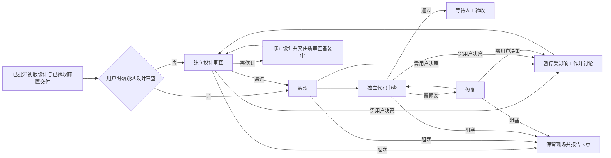

# 长程项目自主推进

## 摘要

本设计定义一种由主控协调、按阶段委派的长程项目推进方式。人类先确认各工作项的需求和初版设计；主控在设计完成、依赖交付经过人工验收后，按用户指定范围并发推动设计审查、实现、独立代码审查和必要修复，直到工作项等待人工验收。主控集中管理项目状态和正式记录，一级执行者对一次阶段工作负责，并可自行组织后代任务。用户始终掌握需求、接口、兼容性和关键约束的变更决定权，最终通过阅读和修改代码完成验收。

## 背景

长程项目通常包含多个有依赖关系的工作项，且每项都要经历设计、实现、审查、修复和验收。逐项人工推动会让用户反复充当调度器；把项目整体交给单一执行者，又难以保持阶段职责、独立审查和结果身份清楚。长任务中断或恢复时，如果不能分辨当前所有者、阶段和有效证据，也可能重复派发任务，甚至让多个执行者同时修改同一工作树。

现有项目机制已提供工作项状态、依赖 DAG、认领、Markdown 草稿发布、dirty 代码快照及独立审查证据等基础能力。项目交付门禁与人工接受也分别表达。自主推进应在这些能力上完成阶段协调、结果归属和授权边界的组合，使重复启动能够延续项目而不抹去人工决策与真实执行历史。

目标用户是负责管理项目的用户和参与阶段工作的执行者。用户用自然语言指定推进范围并提供必要决策；主控把范围转化为可执行集合并持续调度，直到本轮范围全部等待人工验收、已经完成，或所有剩余项均被阻塞且没有运行中的执行者。用户可以在验收、修改和补充决策后再次启动推进。

成功时，每项自动推进都有明确的当前阶段、负责人、输入合同和产物；设计与代码审查由独立执行者基于实际版本作出；自动阶段结束后，用户可以检查并修改代码和设计。遇到超出既有合同的决策、依赖未交付、执行失败或真实宿主能力不足时，系统保留现场并清楚报告，不以摘要、重试次数或 AI 审查通过代替人工验收。

## 设计终态

### 组织与职责

主控从管理项目根目录启动，是项目范围内唯一的调度和持久化控制者。它直接控制所有一级阶段执行者，负责接收用户目标、计算可推进集合、启动和结束阶段工作、管理执行者生命周期、与用户沟通，以及调用项目命令和更新正式项目记录。系统不设置常驻工作项经理或其他中间项目管理层。

每个一级执行者只对一个工作项的一次阶段工作负责。阶段结束后结果返回主控，由主控决定是否启动该项的下一阶段。需要的调查、设计审查、实现、测试、代码审查与修复均由阶段执行者完成。主控可以机械登记和核对执行结果，但不接手补写代码或替代缺失的审查。

同一工作项的当前阶段只有一名一级负责执行者，由主控在该阶段结束后交接给下一阶段执行者。主控可在宿主并发容量内并发推进不同工作项的当前阶段。

| 角色 | 阶段职责 | Codex 固定配置 | Cursor 固定配置 |
| --- | --- | --- | --- |
| 设计审查者 | 使用 `review-design` 检查设计；发现问题时可使用 `explore-design` 协助修正 | `gpt-6.1-sol` / `xhigh` | `grok-4.7` / `xhigh`，非 fast |
| 实现者 | 使用 `implement-design` 实现已批准设计并完成该阶段要求的验证 | `gpt-6.1-sol` / `medium` | `grok-4.7` / `high`，非 fast |
| 代码审查者 | 使用 `review-implementation` 独立审查实现及其实际工件 | `gpt-6.1-sol` / `xhigh` | `grok-4.7` / `xhigh`，非 fast |
| 修复者 | 使用 `receiving-code-review` 处理审查意见并提供复核所需结果 | `gpt-6.1-sol` / `medium` | `grok-4.7` / `high`，非 fast |

设计审查者一旦参与修改设计，就不能独立批准自己参与修订的版本。主控须为新版本安排一名未参与改稿的审查者；该循环持续到设计达到 `implementable`，或需要用户决定。实现者可以承担简单修复，但代码审查仍由独立执行者复核。所有角色继续遵守相应共享技能已有的质量与风险要求。

主控仅根据阶段角色选择一级执行者的固定模型与 effort 模板，不按工作项难度动态选档或自动升级。一级执行者可以自行决定任务拆分、内部组织、结果整合和后代执行者收尾，也可为后代自主选择模型与 effort。主控只控制一级执行者，不管理后代的调度策略，也不把一级角色配置传播为后代限制。实际宿主的工具、并发和权限边界始终生效。

### 范围、依赖与启动条件

用户可以指定全项目、某个工作项及其子项，或若干明确工作项。层级归属用于表达项目组织，不代替依赖 DAG。主控只在指定范围内推进；范围外的前置项可以检查状态和交付证据，但不会因此自动扩张范围。

普通推进要求初版设计已完成并由用户批准需求合同，且所有前置项均完成人工验收及声明的交付义务。明确启用的预研发允许使用前序已完成开发、通过独立代码审查的冻结快照提前推进。缺少初版设计的工作项不由自主推进自动补设计；用户应先补齐并批准合同。

### 预研发与正式收敛

预研发只在用户明确启用的推进范围内生效。启用授权包括将该范围内必要前序的已审查产物提交并推送到新的快照分支，不包括向正式开发分支提交、推送、创建 PR 或确认交付。范围外的前序只使用已有获授权快照或实际交付，不自动扩张范围。普通推进保持原有门禁和源码持久化边界。

快照冻结完整的非忽略源码内容，包括暂存、未暂存和新增文件，以及对应需求、设计、决策、仓库身份和独立审查版本。它使用新的不可变分支和确定的 commit OID；原工作树、分支 HEAD 和暂存区保留。未通过独立代码审查的开发中产物、未收尾的执行者或不确定的发布结果不能成为可用快照。发布中断保留同一快照身份与意图；恢复核对实际远端 OID，不重复创建版本或覆盖已存在的不同内容。

下游固定绑定所需前置快照及其继承的依赖，不追踪快照分支的移动 tip，也不因前序在验收中修改而悄悄切换基线。同仓库的多个前置必须全部进入基线；需要冲突处理时，由实现执行者在独立的基线整合阶段处理，随后再进行设计审查和功能实现。不同仓库保留各自固定快照身份作为上下文，不把无关仓库的提交合并到本仓库。聚合或非源码前置没有可冻结的源码产物时，仍需实际验收交付。

预研发与普通推进一样执行独立设计审查、实现、代码审查和修复，完成后标记为预研发待前序交付。这种标记可沿依赖链传播，供后续预研发继续使用；它不是人工验收或正式交付，也不能解锁普通推进的下游。

所有前置完成人工验收及实际交付后，已完成开发的预研发项必须正式收敛。收敛保留原预研发版本，将自身相对冻结基线的完整修改 rebase 到当前正式基线，排除前序的旧快照提交；冲突与合同内调整由实现执行者处理。新设计审查和新代码审查均不可跳过，必要时继续设计修订、实现和修复，全部通过后才成为正式待人工验收版本。旧预研发 Pass 不可直接转为正式 Pass，即使源码树相同也必须重新审查。人类在正式待验收工作树中仍可检查未提交修改。

基线整合与 rebase 是实现角色的一次独立阶段，不增加工作项经理或新的模型档位。执行者只处理指定临时工作树和已绑定的 Git 输入；主控登记阶段、切换正式开发位置和维护状态。快照和收敛保留原版本与恢复信息；未知写入者、远端分歧、输入不匹配或不可自行决策的冲突只阻塞受影响工作。

主控每次收到有效项目变化、阶段结果或用户决策后，重新计算指定范围内当前可推进的工作项，并并发调度所有就绪项。若宿主容量已满，就保留其余就绪项并排队。范围内某项进入等待人工验收后，该项的自动推进结束，相关执行资源收尾并释放，源码和审查材料留存供人检查。

### 阶段流程

设计审查默认执行。只有用户明确指定的范围可跳过该阶段；执行者不得以工作简单、风险看似较低或自行判断等理由省略。设计审查与实现、代码审查和修复属于一次自动推进闭环；闭环终点是等待用户验收，而不是自动接受设计或宣布项目完成。

用户验收后若设计或源码发生变化，再次明确启动时先核对当前合同、工件及既有证据的有效性，只重做受变化影响的审查或阶段。未受影响且仍有效的独立证据可以复用；恢复不会把已验收工作项无条件送回初版设计阶段。

普通推进的工作项只有完成人工验收及其声明的交付义务后，才按依赖合同解锁下游；整个项目是否完成，仍取决于全部工作项及项目声明的交付义务。

### 角色配置与宿主适配

共享技能定义角色职责和工作合同；各宿主适配维护该宿主的角色模型与 effort 配置，不在技能正文重复整套角色规则。一级配置如上表。Cursor 使用维护时核实的最新 Grok 型号并固定非 fast 变体，本次为 `grok-4.7`；运行时不自行切换型号或速度档。主控模型尚无固定配置；其能力应适合长程协调、合同判断和用户沟通，具体型号由用户选择。

本设计覆盖 Codex 与 Cursor 的不同使用形态，每个宿主的各使用形态共用同一套业务流程和 harness 适配。Qoder 留待后续单独设计，不属于本轮实现范围。适配应表达各宿主真实可用的委派、并发、等待与工具能力；工具调用未发生、执行者无法启动或宿主能力不足时，须按实际结果处理，不能伪造成功或把缺失能力认作审查通过。

### 按职责和模式加载指令

指令按职责分层，入口依据当前上下文主动加载完成任务所需的部分：阶段技能规定各阶段的工作合同和质量要求；通用讨论与授权规则规定问题合并、决策边界和继续执行范围；项目管理规则规定工作项、依赖与项目状态操作；自主推进规则分别说明主控调度和一级执行者职责；宿主适配说明实际委派能力、角色配置和权限。各层只维护自身职责，不要求每个技能复制完整的多模式分支。

原生 Plan 与 Agent 是宿主权限模式，自主推进是工作组织方式。原生 Plan 保持只读，不能通过委派扩大权限；普通单项开发流程继续可用。减少不必要讨论是适用于默认开发、原生 Plan 和其他适用模式的通用优化：先汇总事实、复用已有决定并集中提出真正需要用户选择的问题，只暂停受影响的工作，其余获授权的工作继续进行。长期未回复不构成批准。

### 持久化、身份与证据

项目状态、正式记录和项目 CLI 操作由主控集中负责，包括阶段开始、结束和恢复登记。执行者可以读取主控交付的项目上下文，以及完成任务所需的原始指令、源码和证据；写入范围限于指定源码工作树或指定的候选工件与报告。它们不自行认领项目、不修改项目状态、不登记审查，也不操作项目 Git 或 Aone 发布。

项目持久化与源码交付是两个边界。主控正常持久化项目状态和执行报告；源码在等待人工验收时保持未提交。明确启用的预研发仅为冻结快照及其基线整合、收敛使用独立分支的提交；它不发布正式开发分支或创建 PR。用户验收后的源码交付义务仍按项目合同处理。

每项记录都能区分登记人、真实设计作者、实现者、修复者与独立审查者。主控会话不得冒充所有执行者身份。结果应能关联工作项、阶段、尝试、真实执行者及其输入。审查结论绑定实际设计或代码工件及相应合同版本；代码证据须包含 dirty 工作树的实际内容。摘要中的“已完成”或“测试通过”本身不能证明审查通过。

主控只接受与当前工作项、阶段和有效输入匹配的结果。迟到或已过期的结果不得覆盖当前状态或取代更新版本上的证据。阶段结束后登记的身份、工件、审查结论和阻塞原因足以支持后续恢复与人工核验。

### 授权、讨论与停止条件

用户启动自主推进，即授权主控在指定范围内持续组织设计审查、实现、验证、独立审查、修复和复核；主控不逐阶段询问是否继续。继续执行的授权与改变产品合同的实质决策分开处理。

当已批准需求、接口、兼容性和关键约束保持不变时，执行者可在合同内调整内部方案，并将结果交由适当审查。合同内局部实现、私有类型及类似实现选择由执行者处理，不逐项提交用户决定。若方案会推翻用户明确取舍、改变上述合同、已批准的安全或正确性保证，或改变验收标准，主控暂停受影响工作并组织讨论。系统不得通过降低既定安全或正确性保证、或放宽验收标准来关闭闭环；提示词也不得越过宿主权限。

主控先综合独立调查、代码和审查发现，合并需要用户决定的问题，并说明证据、推荐选项及其后果；已有决定应直接复用。只暂停受决策影响的工作，其余就绪项继续推进。用户长期未回复不构成批准。没有新证据的不确定问题不得通过无限增加审查者或重试来处理；必须由用户决定时，不能靠切换模型替代该决定。审查轮数由具体问题是否已解决决定，不设固定上限。

### 完成、验收与恢复

本轮在指定范围内所有项均处于等待人工验收、预研发待前序交付、已验收待交付或已完成，或其余项全部阻塞且没有运行中的执行者时结束并向用户报告。只要仍有执行者在运行或等待返回，主控就继续跟踪并在结果返回后重新计算范围。等待人工验收、AI 审查通过或本轮主控结束都不代表项目完成，不会解锁普通推进的依赖；明确启用的预研发仅使用已审查冻结快照。

用户验收期间可以修改设计和源码。用户下一次明确启动推进时，主控核对相关合同与工件是否变化，只复用仍与当前版本有效匹配的独立证据；合同变化时，旧批准不得自动延续。系统区分等待人工验收与已验收但尚待交付这两种实际状态，不要求某个特定枚举值。

恢复时，主控保留阶段、工件、执行者结果、阻塞情况和下一步上下文，先确认原任务是否仍在运行及当前负责人。超时、新会话或暂时无响应不构成接管或重派授权；同一工作树不得因盲目重试而产生并发写入。一级执行者负责其后代的结束和资源收尾，主控通过一级执行者管理整棵任务树，不直接介入后代调度。

### 参考

- [提示词最佳实践](../../references/prompting-best-practices.md)
- [OpenAI：Subagents](https://learn.chatgpt.com/docs/agent-configuration/subagents)
- [Cursor：Subagents](https://cursor.com/docs/subagents)
- [Cursor：Grok 4.7](https://cursor.com/docs/models/grok-4-7)

这些宿主文档提供适配参考，不构成端到端能力或本设计已实现的证据。
