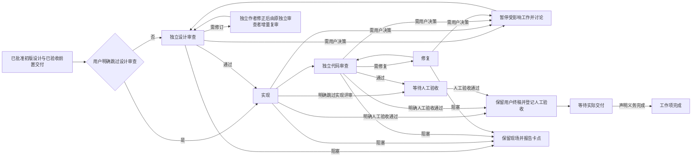

# 长程项目自主推进

## 摘要

本设计定义一种由主控协调、按阶段委派的长程项目推进方式。人类先确认各工作项的需求和初版设计；主控在设计完成、依赖交付经过人工验收后，按用户指定范围串行推动设计审查、实现、独立代码审查和必要修复，直到工作项等待人工验收。主控集中管理项目状态和正式记录，一级执行者对一次阶段工作负责，并可自行组织后代任务。用户始终掌握需求、接口、兼容性和关键约束的变更决定权，最终通过阅读和修改代码完成验收。

下文审查、测试、依赖和交付验证是默认卡点。用户可以明确跳过指定范围内的任何验证卡点；用户明确确认当前实现人工验收通过时，可以替代独立实现评审直接记录通过。系统保留实际用户来源、目标工件及跳过或人工验收标记，不将这些决定记成已执行验证或独立评审。实际宿主权限、数据保护和发布事务完整性仍有各自的保护要求。

## 背景

长程项目通常包含多个有依赖关系的工作项，且每项都要经历设计、实现、审查、修复和验收。逐项人工推动会让用户反复充当调度器；把项目整体交给单一执行者，又难以保持阶段职责、独立审查和结果身份清楚。长任务中断或恢复时，如果不能分辨当前阶段、操作记录和有效证据，也可能重复派发已经完成的任务。

现有项目机制已提供工作项状态、依赖 DAG、Markdown 草稿发布、dirty 代码快照及独立审查证据等基础能力。项目交付门禁与人工接受也分别表达。自主推进应在这些能力上完成阶段协调、结果归属和授权边界的组合，使重复启动能够延续项目而不抹去人工决策与真实执行历史。

目标用户是负责管理项目的用户和参与阶段工作的执行者。用户用自然语言指定推进范围并提供必要决策；主控把范围转化为可执行集合并持续调度，直到本轮范围全部等待人工验收、已经完成，或所有剩余项均被阻塞且没有运行中的执行者。用户可以在验收、修改和补充决策后再次启动推进。

成功时，每项自动推进都有明确的当前阶段、负责人、输入合同和产物；设计与代码审查由独立执行者基于实际版本作出；自动阶段结束后，用户可以检查并修改代码和设计。遇到超出既有合同的决策、依赖未交付、执行失败或真实宿主能力不足时，系统保留现场并清楚报告，不以摘要、重试次数或 AI 审查通过代替人工验收。

## 设计终态

### 组织与职责

主控从管理项目根目录启动，是项目范围内唯一的调度和持久化控制者。它直接控制所有一级阶段执行者，负责接收用户目标、计算可推进集合、启动和结束阶段工作、管理执行者生命周期、与用户沟通，以及调用项目命令和更新正式项目记录。系统不设置常驻工作项经理或其他中间项目管理层。

每个一级执行者只对一个工作项的一次阶段工作负责。阶段结束后结果返回主控，由主控决定是否启动该项的下一阶段。需要的调查、设计审查、实现、测试、代码审查与修复均由阶段执行者完成。主控可以机械登记和核对执行结果，但不接手补写代码或替代缺失的审查。

项目在同一台机器上串行推进，一次完成一个工作项的一个阶段，再由主控登记结果并选择下一阶段。阶段执行者需要委派调查或检查时，依次完成子任务及其收尾。当前阶段阻塞时保留工件，主控可选择范围内另一个就绪项继续。

<!-- known-limit: 项目操作假定单机串行执行；需要多机或并发写入时，须另行设计协调与冲突处理协议。 -->

| 角色 | 阶段职责 |
| --- | --- |
| 设计审查者 | 使用 `review-design` 独立审查；单独的修订执行者使用 `explore-design` 修正实质阻塞问题 |
| 实现者 | 使用 `implement-design` 实现已批准设计并完成验证 |
| 代码审查者 | 使用 `review-implementation` 独立审查实现及其实际工件 |
| 修复者 | 使用 `receiving-code-review` 处理审查意见并提供复核结果 |

设计首次接受完整独立审查。审查者默认只读；对原批准合同或一手证据唯一确定改法、无需设计选择且不改变行为、接口、保证或验收标准的机械错误，可在授权候选内直接修正，记录差异、依据和合同不变，并在同轮对最终精确候选给独立 Pass。这类纠错不列为阻塞项、不构成实质设计作者身份，也不要求更换作者或审查者；缺失设计决策不能伪装为机械错误。设计初版及后续各次实质修订的作者累计保留在作者集合中，不因别人再修订一版而恢复独立审查资格；只有本轮有证据的确定性机械纠错不新增实质作者。实质阻塞发现交由单独的作者或设计修订执行者修正，之后优先复用未参与编写的原审查者，针对变化和关联影响增量复审，并保留仍有效的覆盖。只有原审查者不可用或已参与实质修改目标版本时，才安排另一名独立审查者；审查轮次本身不要求换新上下文。非阻塞意见可以随 Pass 保留。该循环持续到当前设计获得有效覆盖并达到 `implementable`，或需要用户决定。实现者可以承担简单修复，但代码审查仍由独立执行者复核。所有角色继续遵守相应共享技能已有的质量与风险要求。

主控仅根据阶段角色选择一级执行者的固定模型与 effort 模板，不按工作项难度动态选档或自动升级。一级执行者决定任务拆分、内部组织、结果整合和后代收尾，并在宿主能力内选择后代模型。主控只控制一级执行者，不逐个指定后代档位，也不把一级角色配置传播为全体后代的模型。实际宿主的工具和权限边界始终生效。

### 范围、依赖与启动条件

用户可以指定全项目、某个工作项及其子项，或若干明确工作项。层级归属用于表达项目组织，不代替依赖 DAG。主控只在指定范围内推进；范围外的前置项可以检查状态和交付证据，但不会因此自动扩张范围。

推进要求初版设计已完成并由用户批准需求合同，且所有前置项均完成人工验收及声明的交付义务。缺少初版设计时，用户先补齐并批准合同。主控在每次阶段结果、项目变化或用户决策后重新计算范围内的就绪项，依次推进至等待人工验收、已验收待交付、完成或具体阻塞。

### 阶段流程

设计首次完整独立审查默认执行。后续复用有效覆盖，审查变化和关联影响；实质合同、接口、保证、验收标准或关键依赖假设变化需要受影响范围独立复审，只有影响无法界定或原覆盖广泛失效时才扩大为完整复审。文档文字等价整理、无关上下文变化和不改变合同的实现修正不自动触发完整设计复审。用户可明确跳过任何验证卡点，系统按指定范围记录并执行，不换名重新阻塞；执行者不得自行判断跳过。设计审查与实现、代码审查和修复属于一次自动推进闭环；默认终点是等待用户验收，用户明确人工验收当前实现通过，则读取最终代码与设计，保留用户定稿文本，仅同步仍待校准的旧设计描述，登记实际验收来源并进入等待交付。该目标无需另做独立代码/设计审查或重复确认设计。

人工验收阶段，用户可以任意修改代码和设计，修改结果直接作为终稿，无需再次设计审查、代码审查或自动修复。已有验收结论时，记录真实的用户终稿来源并沿用结论刷新当前绑定；尚无验收结论时继续等待结论。旧独立审查保留原目标与身份。票据打开期间输入变化仍触发陈旧输入保护，重新读取终稿登记即可，无需重复批准。

普通推进的工作项只有完成人工验收及其声明的交付义务后，才按依赖合同解锁下游；整个项目是否完成，仍取决于全部工作项及项目声明的交付义务。

### 执行能力与绑定

共享技能定义角色职责和工作合同。调用方提供可用执行者、项目命令入口、稳定会话身份及权限边界；公共层不发现或引用具体平台实现。缺失必要能力、实际调用失败或执行者无法启动时，保留现场并报告，不能伪造成功或把缺失能力认作审查通过。执行者的实际能力须适合所分配的职责。

### 按职责和模式加载指令

指令按职责分层，入口依据当前上下文主动加载完成任务所需的部分：阶段技能规定各阶段的工作合同和质量要求；通用讨论与授权规则规定问题合并、决策边界和继续执行范围；项目管理规则规定工作项、依赖与项目状态操作；自主推进规则分别说明主控调度和一级执行者职责；宿主适配说明实际委派能力、角色配置和权限。各层只维护自身职责，不要求每个技能复制完整的多模式分支。

只读规划与普通执行遵循调用方的实际权限，自主推进定义工作组织方式。只读规划保持只读，不能通过委派扩大权限；普通单项开发流程继续可用。减少不必要讨论是适用于普通开发、只读规划和其他适用模式的通用优化：先汇总事实、复用已有决定并集中提出真正需要用户选择的问题，只暂停受影响的工作，其余获授权的工作继续进行。长期未回复不构成批准。

### 持久化、身份与证据

项目状态、正式记录和项目 CLI 操作由主控集中负责，包括阶段开始、结束和恢复登记。执行者可以读取主控交付的项目上下文，以及完成任务所需的原始指令、源码和证据；写入范围限于指定源码工作树或指定的候选工件与报告。正式项目状态、审查登记及项目 Git/Aone 发布由主控完成。

项目持久化与源码交付分别记录。主控通过项目命令持久化状态和执行报告；源码在等待人工验收时保持未提交。用户验收后的源码交付义务按项目合同及实际发布授权处理。

每项记录都能区分登记人、真实设计作者、实现者、修复者与独立审查者。主控会话不得冒充所有执行者身份。结果应能关联工作项、阶段、真实执行者及其输入。审查结论绑定实际设计或代码工件及相应合同版本；代码证据须包含 dirty 工作树的实际内容。设计覆盖复用须保留原始审查身份和输入、当前精确工件身份、已检查差异、保留覆盖及失效范围。已有真实独立 Pass 时，获授权的项目操作者或主控可通过 `design-reuse` 检查合同和关键假设是否仍保持不变，并保留原审查者、批准及来源，建立当前绑定和适用性报告；这是沿用原独立结论，不产生新独立 Pass，也不是审查豁免。没有原始 Pass、已有更新的失败审查或尚待用户决定时不得复用；无法确认适用性则转受影响范围独立复审。字节绑定过期不等于语义上的用户批准被撤销；已确认适用性的操作者复用无需新的独立确认，无法确认而进入待比较候选时才由独立审查者确认合同保持不变。程序校验身份、哈希和陈旧写入，不自动判定语义等价。主控自述不能伪造独立 Pass。摘要中的“已完成”或“测试通过”本身不能证明审查通过。

主控只接受与当前工作项、阶段和有效输入匹配的结果。迟到或已过期的结果不得覆盖当前状态或取代更新版本上的证据。阶段结束后登记的身份、工件、审查结论和阻塞原因足以支持后续恢复与人工核验。

### 授权、讨论与停止条件

用户启动自主推进，即授权主控在指定范围内持续组织设计审查、实现、验证、独立审查、修复和复核；主控不逐阶段询问是否继续。继续执行的授权与改变产品合同的实质决策分开处理。

当已批准需求、接口、兼容性和关键约束保持不变时，执行者可在合同内调整内部方案，并将结果交由适当审查。合同内局部实现、私有类型及类似实现选择由执行者处理，不逐项提交用户决定。若方案会推翻用户明确取舍、改变上述合同、已批准的安全或正确性保证，或改变验收标准，主控暂停受影响工作并组织讨论。系统不得通过降低既定安全或正确性保证、或放宽验收标准来关闭闭环；提示词也不得越过宿主权限。

主控先综合独立调查、代码和审查发现，合并需要用户决定的问题，并说明证据、推荐选项及其后果；已有决定应直接复用。只暂停受决策影响的工作，其余就绪项继续推进。用户长期未回复不构成批准。没有新证据的不确定问题不得通过无限增加审查者或重试来处理；必须由用户决定时，不能靠切换模型替代该决定。审查轮数由具体问题是否已解决决定，不设固定上限。

### 完成、验收与恢复

本轮在指定范围内所有项均处于等待人工验收、已验收待交付、已完成或具体阻塞，且当前阶段及子任务已收尾时结束并向用户报告。主控等待当前阶段返回，再登记结果并选择下一阶段。只有实际人工验收及声明的交付义务完成后，工作项才满足下游的交付前提。

用户验收期间可以修改源码。收到明确的人工验收通过结论后，主控使用 `begin human-acceptance ID --approval-source SOURCE` 读取当前设计与代码位置，检查设计偏移，保留用户定稿的代码与设计，仅在返回的 spec 草稿中同步仍待校准的旧描述，并在报告中说明验收来源、用户终稿来源、代码快照、比较范围和差异。finish 将必要的设计修订与验收绑定一并发布；设计版本依据最后登记摘要计算，直接编辑磁盘中的 spec 也会在登记时递增一次，相同终稿不重复增加版本。已有人工验收覆盖这次事实性设计校准，旧独立审查记录保留原身份与目标，不生成虚构的独立 Pass。比较期间代码或原始输入发生变化时拒绝陈旧证据，部分发布沿用原事务恢复。

现有 `awaiting_delivery` 状态承载人工验收阶段。用户通过 `design-update --finalization-source SOURCE` 定稿设计时，程序保留该阶段和既有验收来源，使用现有代码位置完成登记。`human-acceptance --finalization-source SOURCE` 可以沿用已有实际验收结论刷新最终代码与设计绑定；终稿来源本身不能制造验收通过。用户设计终稿由 `design.finalization` 保留来源与摘要，自动代码校准应保留该文本。管理仓库保留原有干净工作区发布边界；通过返回的草稿登记设计，直接编辑的管理文档先按原提交约定保留，源码工作树的未提交修改照常进入验收快照。

只更新当前工作项的设计。后续工作项保留原 spec，在各自设计审查中读取最新前置设计并处理矛盾；已有输入哈希检查使受影响的旧证据失效。人工验收时可能已创建 PR 或进入其他交付步骤，主控记录实际进展与剩余义务；PR 本身不能证明人工验收通过。设计校准与验收登记完成后处于已验收待交付，声明的实际交付义务满足后工作项才完成。

任意本机会话均可读取当前项目工件和操作记录，继续获授权的工作项操作。先恢复并核实未完成的发布事务，再开始下一次写入；沿用已有票据时保留原操作和真实作者、审查者的来源。用户修改合同或工件后，检查既有批准和审查证据的适用范围，仅重做失效部分。程序校验当前输入、实际结果和发布完整性；会话身份用于真实贡献归属。

### 参考

- [提示词最佳实践](../../references/prompting-best-practices.md)
