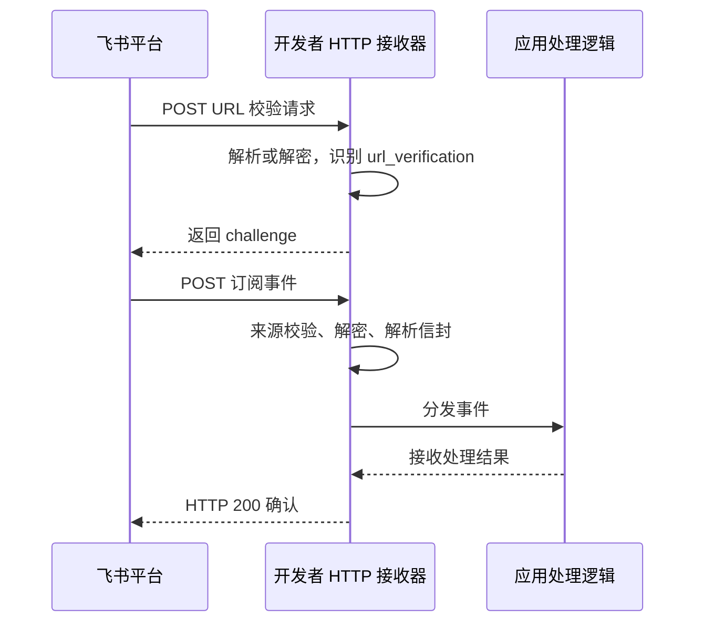
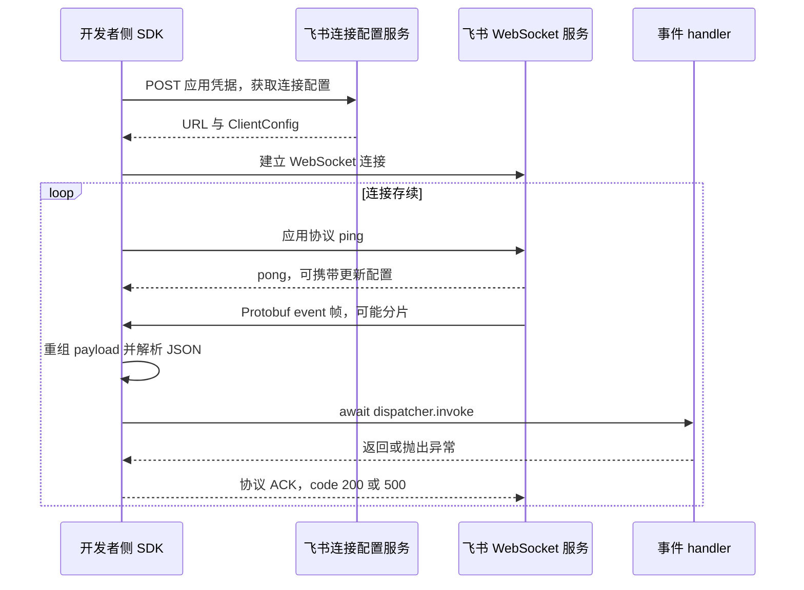

# 飞书 Webhook 与 WebSocket 事件接收原理

调研日期：2026-11-03。关联工作项：`2-feishu-wake-openclaw`。本文记录平台契约、官方 SDK 实现及其对 Sandbox 唤醒的约束，不代表已批准的设计或运行验证。OpenClaw 自身的处理链路见 [OpenClaw 飞书 IM 接入机制](openclaw-feishu-im-mechanism.md)。

证据分为两类：飞书官方文档描述服务契约；官方 `larksuite/node-sdk` 源码固定在提交 [`b188be60134d409b61259546bcf69c731d2b0b7c`](https://github.com/larksuite/node-sdk/tree/b188be60134d409b61259546bcf69c731d2b0b7c)，其 `package.json` 标注版本 `1.76.0`。这不表示项目或实际 OpenClaw 已安装该版本。文档通过官方页面及搜索索引返回的正文核验，部分页面直接打开时没有可读正文；未使用第三方文章作为结论依据。

## 1. 先区分消息方向和事件类型

本专题的 Webhook 指应用的**事件接收 URL**：飞书主动向开发者服务器推送事件。WebSocket 则由开发者侧 SDK 主动建连，飞书沿已建立的连接推送事件。两者都是接收入口；回复 IM 消息通常另行调用消息发送或回复 API，不能把事件 ACK 当成机器人回复。[事件订阅概览](https://open.feishu.cn/document/uAjLw4CM/ukTMukTMukTM/event-subscription-guide/event-subscriptions)、[消息 API 概览](https://open.feishu.cn/document/uAjLw4CM/ukTMukTMukTM/reference/im-v1)

还须区分三个名称相近的对象：

| 对象 | 含义与确认语义 |
| --- | --- |
| 订阅事件，例如 `im.message.receive_v1` | 通知应用发生了什么；平台有确认、重试与重复投递机制 |
| 同步交互回调，例如卡片操作、链接预览 | 需要在响应中返回交互结果；官方说明同步回调不提供补推，不能套用消息事件的重试规则 |
| 群自定义机器人的 Webhook | 开发者调用飞书提供的地址向群发送消息；不是本专题的接收地址 |

来源：[接收交互回调](https://open.feishu.cn/document/event-subscription-guide/callback-subscription/receive-and-handle-callbacks)、[自定义机器人指南](https://open.feishu.cn/document/client-docs/bot-v3/add-custom-bot)。

## 2. 两种接收方式的共同点与区别

| 维度 | Webhook | WebSocket 长连接 |
| --- | --- | --- |
| 网络发起方 | 飞书发起 HTTP POST | 开发者侧 SDK 主动向飞书发起连接 |
| 网络条件 | 飞书可访问的回调入口 | 接收进程可访问飞书服务，无须公网入站回调地址 |
| 接收前准备 | 配置 URL 并完成 challenge 校验 | 使用应用凭据启动 SDK，建立在线连接 |
| 认证边界 | 每次请求按配置验签、校验 token、解密 | 建连时认证，业务 handler 无须再次执行 Webhook 验签解密 |
| 事件数据 | HTTP JSON 信封，可包含加密字段 | 二进制协议帧携带事件，SDK 重组并解析为对象 |
| 接收确认 | HTTP 200 | SDK 在连接上发送协议 ACK，payload 中包含结果码 |
| 多副本 | 开发者负责入口负载均衡及共享幂等状态 | 同应用的连接组成集群，单条消息随机交给一个客户端，不广播 |
| 接收进程休眠 | 请求不能得到正常处理，可能超时重推 | 无法执行 handler、心跳和重连；已有 TCP 连接不等于仍有业务接收能力 |

飞书把 Webhook 与长连接列为可选订阅方式；不能假定同一应用的同一事件会通过两者同时双发。长连接文档限定企业自建应用、每应用最多 50 条连接，且保存长连接订阅配置时需要已有在线客户端。数字和应用类型限制属于调研时的官方契约，应在选型时复核。[长连接接入文档](https://open.feishu.cn/document/ukTMukTMukTM/uYDNxYjL2QTM24iN0EjN/event-subscription-configure-)

## 3. Webhook：请求地址校验与事件推送



URL 校验请求以 `type: url_verification` 标识，接收器返回 JSON 中同值的 `challenge`。加密场景先解密；它不是聊天消息，不应进入 Agent 业务处理。固定 SDK 的 `generateChallenge` 会在配置 Verification Token 时验证 token；`adaptDefault` 只有启用 `autoChallenge` 才自动处理此流程。[challenge 实现](https://github.com/larksuite/node-sdk/blob/b188be60134d409b61259546bcf69c731d2b0b7c/adaptor/services/challenge.ts)、[HTTP 适配器](https://github.com/larksuite/node-sdk/blob/b188be60134d409b61259546bcf69c731d2b0b7c/adaptor/default.ts)

普通 v2 事件使用 `schema`、`header`、`event` 信封；其中 `header.event_type` 选择处理器，`header.event_id` 标识事件，`app_id`、`tenant_key` 提供应用及租户上下文。SDK 会将信封解析并展平后传给 handler，因此 SDK handler 收到的对象不一定保留原始 HTTP 层级。保留或转交原始事件时需明确使用哪个层级。[解析与分发实现](https://github.com/larksuite/node-sdk/blob/b188be60134d409b61259546bcf69c731d2b0b7c/dispatcher/request-handle.ts)、[事件 dispatcher](https://github.com/larksuite/node-sdk/blob/b188be60134d409b61259546bcf69c731d2b0b7c/dispatcher/event.ts)

### 鉴权、加密和凭证的区别

| 凭证 | 用途 |
| --- | --- |
| App ID / App Secret | 应用身份；长连接获取连接配置时使用，也用于服务端 API 的凭证流程 |
| Verification Token | 校验收到的事件/URL 校验请求是否匹配配置 |
| Encrypt Key | Webhook 载荷解密及请求签名校验所用的密钥 |
| API access token | 调用发送消息等业务 API；不是事件 ID，也不是事件 ACK |

官方签名算法是对以下字节序列计算 SHA-256 hex，再与 `X-Lark-Signature` 比较：

```text
UTF8(X-Lark-Request-Timestamp + X-Lark-Request-Nonce + EncryptKey)
    || 原始 HTTP body 字节
```

这不是 HMAC-SHA256。原始 body 的空白、转义、字段序列发生变化也可能改变签名。启用加密后，外层 `encrypt` 经 Base64 解码，前 16 字节为 IV，后续为 AES-256-CBC 密文；AES key 是 `SHA256(EncryptKey)` 的字节结果。Verification Token 在加密体内时要先解密才能读取。仅靠明文 token 的校验与签名校验具有不同的安全边界。[官方校验与解密说明](https://open.feishu.cn/document/event-subscription-guide/callback-subscription/receive-and-handle-callbacks)、[官方 SDK AES 实现](https://github.com/larksuite/node-sdk/blob/b188be60134d409b61259546bcf69c731d2b0b7c/utils/aes-cipher.ts)

**SDK 实现边界：**固定 Node SDK 的 `RequestHandle.checkIsEventValidated` 使用 `JSON.stringify(data)` 计算摘要，而其默认 HTTP 适配器先解析 JSON。它与文档要求的原始字节边界并不天然等价；不能据此断言任意重新序列化都保持签名有效。该函数也未实施通用时间戳新鲜度检查；签名存在不自动意味着已有防重放策略。两项均为源码观察，未在实际飞书投递中验证。[验签源码](https://github.com/larksuite/node-sdk/blob/b188be60134d409b61259546bcf69c731d2b0b7c/dispatcher/request-handle.ts)、[请求解析源码](https://github.com/larksuite/node-sdk/blob/b188be60134d409b61259546bcf69c731d2b0b7c/adaptor/pick-request-data.ts)

## 4. WebSocket：建连、协议帧与 ACK

以下内部机制绑定所读 SDK 提交，不把内部 endpoint、帧字段或默认参数视为独立且永久稳定的公共协议。



### 建连与重连

1. `pullConnectConfig` 向 `${domain}/callback/ws/endpoint` 发起 POST，常规凭据为 `{AppID, AppSecret}`。响应返回连接 URL 和 `ClientConfig`。该版本还支持 Client Assertion 凭据路径；本次项目未选择或验证它。
2. SDK 使用返回 URL 建立连接，并保存 `device_id`、`service_id` 等连接信息；不是把 App Secret 当作一条聊天消息发进 WebSocket。
3. `ClientConfig` 给出心跳间隔、重连次数、重连间隔及随机等待参数。SDK 主动发应用协议 ping，pong 可以更新这些参数。
4. `autoReconnect` 默认开启；断开后按 SDK 和服务端配置重连，初始等待含随机扰动。固定代码允许无限重连次数配置，也允许关闭自动重连。具体时长不能仅凭源码默认值当作平台 SLA。

来源：[连接配置](https://github.com/larksuite/node-sdk/blob/b188be60134d409b61259546bcf69c731d2b0b7c/ws-client/index.ts#L268-L355)、[重连实现](https://github.com/larksuite/node-sdk/blob/b188be60134d409b61259546bcf69c731d2b0b7c/ws-client/index.ts#L421-L586)、[心跳实现](https://github.com/larksuite/node-sdk/blob/b188be60134d409b61259546bcf69c731d2b0b7c/ws-client/index.ts#L588-L687)。

### 帧、分片与缓存

SDK 通过 Protobuf `Frame` 编解码二进制消息；控制帧与数据帧由 `method` 区分，headers 中的 `type` 再区分 ping、pong、event 等。业务事件的 JSON 在 payload 内，不能把整个 WebSocket 帧直接当 JSON 转发。[Frame 定义](https://github.com/larksuite/node-sdk/blob/b188be60134d409b61259546bcf69c731d2b0b7c/ws-client/proto-buf/pbbp2.js#L249-L393)

数据帧的 `message_id`、`sum`、`seq` 用于应用协议的分片重组。`DataCache` 是单客户端实例的内存 Map；收齐后拼接并解析 JSON，完成即删除。它每 10 秒扫描并清理年龄大于 10 秒的残片，客户端显式关闭时清空。它不是事件持久化队列，也不是业务去重表；该过期值不表示平台离线消息保留期。[分片缓存实现](https://github.com/larksuite/node-sdk/blob/b188be60134d409b61259546bcf69c731d2b0b7c/ws-client/data-cache.ts)

### handler 与确认的先后关系

`handleEventData` 等待 `eventDispatcher.invoke` 完成，然后发送协议 ACK：正常返回为 `code: 200`，抛异常为 `code: 500`。这里的 200/500 位于 WebSocket 帧 payload 中，不是额外发起了一次 HTTP 响应。分片尚未收齐不会分发，解析或重组失败路径不会发送成功 ACK。[事件处理及 ACK](https://github.com/larksuite/node-sdk/blob/b188be60134d409b61259546bcf69c731d2b0b7c/ws-client/index.ts#L690-L757)

所读路径没有三秒自动取消 handler 的本地机制。慢 handler 会延后 ACK；handler 自行启动后台任务并立即返回，则 ACK 可能早于任务完成。由此可推得：SDK 确认成功不能证明业务结果完成或事件已经持久化，责任在应用接收边界。

## 5. 事件超时、重试、去重与顺序

飞书事件订阅文档给出的确认窗口是三秒；HTTP 路径还列出 TCP 建连超时两秒。长连接 handler 也应在三秒内完成且不抛异常。失败后按 15 秒、5 分钟、1 小时、6 小时的间隔重试，最多四次；平台采用至少一次投递，成功接收也可能因链路异常重复。文档只对部分事件说明有序投递，不能推出全部 IM 消息具有跨连接、跨实例的全局顺序。[事件订阅契约](https://open.feishu.cn/document/uAjLw4CM/ukTMukTMukTM/event-subscription-guide/event-subscriptions)

三个标识不能混为一谈：

| 标识 | 所属层级 | 作用 |
| --- | --- | --- |
| v1 `uuid` / v2 `header.event_id` | 事件信封 | 官方建议用于事件重复判断 |
| `event.message.message_id` | IM 业务消息 | 标识聊天消息，供消息 API 和业务幂等使用 |
| WebSocket frame header `message_id` | 传输协议 | SDK 用于组装本次协议载荷，不应替代事件或 IM 消息标识 |

业务去重还需保留应用/租户作用域及实际业务操作边界，不能把“收到相同事件”与“业务副作用仅发生一次”等同。事件发送成功、SDK ACK 成功、应用持久化成功、机器人回复成功是不同事实。[官方事件契约](https://open.feishu.cn/document/uAjLw4CM/ukTMukTMukTM/event-subscription-guide/event-subscriptions)、[SDK 事件类型](https://github.com/larksuite/node-sdk/blob/b188be60134d409b61259546bcf69c731d2b0b7c/code-gen/events-template.ts#L4419-L4467)、[SDK 分片与 ACK 路径](https://github.com/larksuite/node-sdk/blob/b188be60134d409b61259546bcf69c731d2b0b7c/ws-client/index.ts#L690-L757)

本次未找到“完全离线期间的所有事件会无限保存，恢复连接后必然补齐”的官方保证。有限失败重试和 SDK 自动重连均不能证明这一点。HTTP 返回成功后再丢失内存任务，也不能期待飞书知道内部失败并主动补发。

## 6. 同步回调的适用性边界

飞书回调文档描述卡片交互等回调需要三秒内响应，并明确它们是同步操作、不提供补推；同页描述了平台的长连接回调方式。[官方回调文档](https://open.feishu.cn/document/event-subscription-guide/callback-subscription/receive-and-handle-callbacks)

但固定 Node SDK 的 README 仍说明长连接只支持事件订阅；实际 `handleEventData` 对 `type != event` 直接返回。因此，平台存在长连接回调能力，不等于这个 SDK 的事件路径已支持全部交互回调。后续如纳入卡片操作，应针对目标 SDK、版本与具体回调重新核验，不能把本专题的消息事件结论直接复用。[SDK README](https://github.com/larksuite/node-sdk/blob/b188be60134d409b61259546bcf69c731d2b0b7c/README.zh.md#L618-L635)、[事件帧筛选](https://github.com/larksuite/node-sdk/blob/b188be60134d409b61259546bcf69c731d2b0b7c/ws-client/index.ts#L690-L701)

## 7. 对通用 Sandbox 唤醒能力的研究结论

以下是基于机制的推论，尚未选定组件、仓库或交付设计：

- **接收器存活是前提。** 当 SDK 与应用一起 Pause 时，无法靠该 SDK 主动处理消息来唤醒自身。需要一个仍可工作的外部接收/转发环节，或另有独立唤醒信号。
- **Webhook 有入站请求，长连接依赖已有出站连接。** 前者有接入流量唤醒入口的可能，但仍受三秒确认窗口与入口鉴权约束；后者不会自动转换成 Sandbox 网关的新 HTTP 请求。
- **额外开一个同应用长连接不能实现旁路监听。** 平台会把事件分给其中一个客户端；必须明确哪个接收方负责消息，避免原应用与唤醒组件竞争消费。
- **首条消息的保留与唤醒是两个问题。** 唤醒成功不表示首条事件仍可用；如果外部接收层提前确认，它需要承担确认后的保存与交付责任。
- **通用抽象应保留协议差异。** 来源接入需要提供认证后的身份、稳定事件标识、确认规则和原始业务载荷；同步回调还涉及即时响应，不能统一假设可以先 ACK、再任意延迟处理。

## 8. 验证边界与后续复用

已执行：官方文档检索、固定提交的 SDK 源码阅读、Webhook 与 WebSocket 调用链交叉核对。未执行：配置真实飞书应用、发送真实消息、抓包、断线补投实验、SDK 运行测试、Sandbox Pause/Resume 或 OpenClaw 端到端验证。

复用本知识前应核对实际应用类型、订阅方式、消息权限和可见范围、SDK/插件版本、接收进程所在位置。对于断线补投、冷启动耗时和首次消息处理，保留为需要真实环境验证的事项。项目此前提出的“Webhook 与 WebSocket 都支持、能力通用”是用户要求；本研究没有把候选外置网关设计记录为用户批准。
