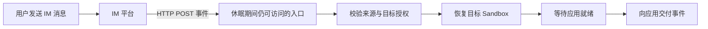
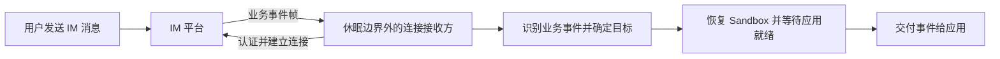

# Webhook 与 WebSocket IM 唤醒链路、休眠行为与能力边界

分析日期：2026-11-03。关联需求：`2-feishu-wake-openclaw`（Webhook 唤醒）与 `3-websocket-wakeup`（WebSocket 唤醒）。本文保存基于飞书原理的分析，供通用 IM 唤醒能力设计使用；候选链路不代表已批准的组件方案。

协议事实及固定版本 SDK 证据见 [飞书事件接收原理](feishu-event-transports.md)，应用侧行为见 [OpenClaw 飞书接入机制](openclaw-feishu-im-mechanism.md)。本文复用这些调研结果，没有新增真实环境验证。

## 1. 共同目标与成功边界

目标是：已有 Sandbox 处于 Pause 时，合法 IM 消息触发目标 Sandbox 恢复，使其中的应用重新具备处理消息的能力。飞书和 OpenClaw 是首个验证场景，能力应能扩展到其他 IM 平台和应用。

需要分别定义三个结果：Sandbox 已恢复、应用已就绪、触发消息已被应用处理。三者不能用同一个 ACK 或运行状态替代。是否要求首条消息保留、何时向上游确认、失败如何重试，仍需在需求细化和设计中确定。

## 2. Webhook 唤醒

### 链路

飞书向事件接收 URL 发起新请求，因此可以把始终可访问的入口作为唤醒触点。入口可以复用适用的网关机制，也可以采用独立接收器；本分析不选定部署形式。

较小的候选实现是入口持有请求，恢复 Sandbox 后转发并返回应用响应。它需要检验冷启动能否满足平台确认窗口。飞书事件要求三秒内确认，并提供有限失败重试；慢恢复可能导致首次超时、重复请求，以及恢复完成后已无有效请求可以转发。[飞书事件订阅契约](https://open.feishu.cn/document/uAjLw4CM/ukTMukTMukTM/event-subscription-guide/event-subscriptions)

另一种候选是入口校验并可靠接收事件后先确认，再异步恢复和交付。它把上游确认与应用处理分开，也把确认后的保存、重试及失败责任交给接收层。持久化队列不是“仅触发恢复”的必然前提；若承诺确认后的消息可靠交付，则需相应的可靠保存与交付机制。

### 休眠期间可能发生的事情

| 情况 | 影响 |
| --- | --- |
| 应用内 HTTP 接收器随 Sandbox Pause | 无法处理请求，需要外部可达入口接住请求或发起恢复 |
| 恢复超过确认期限 | 上游可能超时重投；原请求取消后恢复是否继续需明确 |
| 平台重试结束前仍未恢复 | 不能假设平台永久保存并继续补投 |
| 多条不同消息同时到达 | 可以合并恢复操作，但不能把不同事件一起去重丢弃 |
| 同一事件重复投递 | 恢复幂等和业务处理幂等需要分别保证 |
| 提前确认后接收器丢失内存任务 | 平台不知道内部丢失，接收层承担已作出的交付承诺 |
| challenge、非法请求或不属于目标的事件到达 | 需在协议或授权边界处理，不能一概当作业务唤醒信号 |

### 所需能力

- 休眠期间仍可访问的 HTTP 入口，来源校验、必要的解密和协议校验响应。
- 从认证后的应用、租户、路由等上下文确定目标，并在恢复前完成唤醒授权。校验可由入口或明确可信的上游承担，后续业务鉴权不能替代这一边界。
- 幂等恢复、并发恢复合并、失败处理和应用就绪判定。
- 对请求超时、取消与上游重试的明确处理；按最终承诺选择同步转发或可靠接收后异步交付。
- 应用事件交付适配、稳定事件身份、业务幂等及故障定位信息。

## 3. WebSocket 唤醒

### 暂停应用内客户端的后果

飞书长连接由客户端主动建立。Sandbox Pause 后，客户端无法执行 handler、应用协议心跳或断线重连。已有连接是否立即消失取决于 Sandbox 和网络实现；连接暂时存在不代表应用还能处理消息。

暂停初期，部分字节可能进入网络或系统缓冲区。TCP ACK、已收字节和业务协议 ACK 是不同层次，这些暂存都不构成持久消息保障。之后连接可能因心跳缺失、服务端超时或网络变化断开。恢复后的 SDK 重连也不能证明离线期间全部事件必然补齐。

飞书官方 SDK 的事件路径需要解析协议帧、重组载荷、调用 handler，再发送业务协议 ACK。控制帧与事件帧用途不同，平台有限失败重试也没有给出无限离线保留保证。[固定版本 SDK](https://github.com/larksuite/node-sdk/blob/b188be60134d409b61259546bcf69c731d2b0b7c/ws-client/index.ts#L588-L757)、[事件订阅契约](https://open.feishu.cn/document/uAjLw4CM/ukTMukTMukTM/event-subscription-guide/event-subscriptions)

### 链路及兼容范围

覆盖旧连接已经失效的长期休眠，需要在暂停边界外保留可工作的连接接收责任，或通过独立机制取得消息唤醒信号。

| 候选兼容范围 | 需要解决的事情 |
| --- | --- |
| 外部通过平台 SDK 接收，再经 HTTP、插件或内部接口交付应用 | 外部连接所有权、应用接收接口与 ACK/交付边界；可能需要应用适配 |
| 保留应用原有 WebSocket 客户端方式，通过代理承接暂停期间接收责任 | 会话、协议、凭据、控制帧、确认和恢复后连接接续；普通四层转发本身不能执行这些业务协议职责 |

这两种候选的兼容成本不同，需要在需求细化时选定。内部 HTTP 交付接口不等于依赖“接收飞书公网 Webhook”的另一项功能。

飞书同一应用的多个长连接客户端会竞争接收，单条事件随机分给一个客户端。额外客户端不能作为广播式旁路监听器；接收方和原应用之间必须明确消息所有权。[飞书长连接接入文档](https://open.feishu.cn/document/ukTMukTMukTM/uYDNxYjL2QTM24iN0EjN/event-subscription-configure-)

### 休眠期间可能发生的事情

| 情况 | 影响 |
| --- | --- |
| 应用内 SDK 暂停，连接暂时未关闭 | handler 与心跳仍不能执行，缓冲数据不等于可靠接收 |
| 旧连接失效且无人维持外部接收 | 消息缺少即时唤醒入口，不能依赖暂停中的 SDK 自行恢复 |
| 外部接收方继续心跳及重连 | 可保持接收责任；心跳和普通重连本身不应触发业务唤醒 |
| 外部接收方提前成功 ACK | 之后的保存与交付失败由其负责 |
| 等待应用处理完成才 ACK | 可能超过平台确认期限并收到重复事件 |
| 外部与应用同时建立同应用长连接 | 平台竞争分发，旁路连接不保证收到另一客户端消费的消息 |
| 接收方断线、重启或收到不完整事件 | 需处理重连、残片与失败边界；SDK 内存分片缓存不能代替可靠存储 |

### 所需能力

- 暂停边界外的连接生命周期管理：认证、建连、心跳、断线检测、重连及接收方故障恢复。
- 平台协议适配：控制/业务事件区分、必要的分片重组、稳定事件身份和协议 ACK；评估适用 SDK 及版本。
- 唯一或协调的连接/消费责任，避免原应用和接收组件非预期竞争，具体多实例机制待设计。
- 目标映射与授权、恢复合并、就绪检测及失败处理。
- 明确的确认时点和确认后保存责任，以及应用交付接口、重试和业务幂等。
- 若要求应用原连接方式保持不变，还需协议代理和会话接续能力，并验证透明兼容范围。

## 4. 独立性与共享边界

两个入口可以分别配置、验证和独立交付。Webhook 唤醒不要求先具备 WebSocket 接收能力，WebSocket 唤醒也不要求先具备公网 Webhook 接收能力，因此可以拆成两个并列需求。

| 能力 | Webhook 唤醒 | WebSocket 唤醒 |
| --- | --- | --- |
| 上游接入 | 被动接收 HTTP 请求 | 主动建立和维持长连接 |
| 来源认证、协议确认 | Webhook 规则 | 连接及事件协议规则 |
| 目标映射与授权、幂等恢复、就绪检测 | 可共享 | 可共享 |
| 事件身份、可观测性、应用交付 | 复用适用部分 | 复用适用部分 |
| 可靠保存与异步交付 | 按消息可靠性承诺决定 | 按消息可靠性承诺决定 |
| 会话、心跳、重连和消费协调 | 无相同入口职责 | 专有能力 |

共享能力应由一个明确的实现边界负责，避免两个需求各自引入冲突的恢复规则。只有确认存在需独立交付的共同增量后，才有必要新增共同前置项。当前不人为设置两项相互依赖，也不直接认定工作项 1 已交付或覆盖全部需要。

## 5. 验收细化方向与验证边界

Webhook 应验证：Sandbox 已 Pause，合法 HTTP 事件到达入口，正确目标恢复，应用达到约定的可用状态；并检验超过确认窗口、事件重复和消息并发时的约定结果。

WebSocket 应验证：Sandbox 已 Pause 且旧连接已失效，仍可接收业务事件并恢复正确目标；并检验心跳不唤醒、接收方断线重连、事件重复与恢复后的交付责任。

两项均需明确首条消息处理承诺、确认后失败责任、完成与时延标准、租户授权及手动 Pause/禁用自动唤醒策略。这里是细化方向，不把未定数值或可靠性等级记为用户批准。

本文是协议资料与固定 SDK 源码支持的机制分析。尚未执行真实飞书消息、抓包、长时间 Pause、旧连接失效、断线补投、冷启动耗时或 OpenClaw 端到端实验，需在目标部署与版本上验证。
