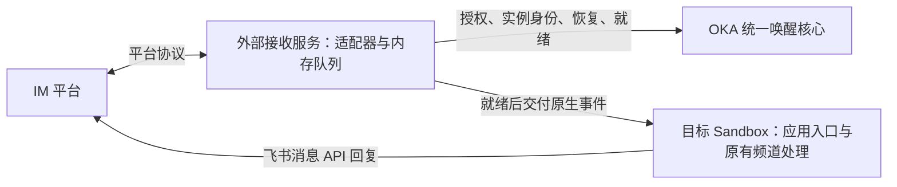

# 基于 WebSocket 事件的 Sandbox 自动唤醒

## 摘要

由暂停边界外持续运行的接收服务维护 IM 连接，接纳完整业务事件到内存并按平台协议及时确认，再通过统一唤醒能力恢复固定绑定的已有 Sandbox，向应用内部入口交付原生事件。平台协议由适配器负责，目标授权、实例身份、恢复和就绪语义由 OKA 统一处理。

首期交付公共接收／唤醒／交付框架、飞书普通消息适配及 OpenClaw 应用接入。每个账号／接入绑定一个已有 Sandbox；应用允许调整接收方式。采用单活、受控重启和有限处理预算，接受接收进程退出丢失已确认的内存消息。应用接纳、Agent 执行和最终回复分别观察。

## 背景

Sandbox Pause 后，内部客户端不能执行消息处理、心跳或重连。旧连接全部失效时，仅由沙箱内应用直接连接 IM，无法提供持续的外部消息感知责任；短暂的连接或缓冲区存续也不能替代这一责任。平台有限重试不构成无限离线保留保证。

用户需要统一方案应对不同 IM，而不是依赖某个平台额外广播消息、断线自动切换接收协议或沙箱内原连接幸存。用户允许调整应用接入方式，并接受内存消息及有限重试的失败边界，因此采用外部接收服务和应用薄适配入口，不建设透明会话代理或持久消息系统。

飞书和 OpenClaw 是首个完整链路场景。现有平台 SDK 的分片重组、协议确认及应用已有的频道入队、去重、访问策略和回复能力可以复用；统一能力仍需明确连接所有权、可信目标绑定及内部接纳回执。协议与应用事实的固定版本证据见本项 [上下文](context.md) 和 [链路分析](../../evidence/im-wakeup-paths-and-capabilities.md)。

## 设计终态

### 范围与责任

能力面向已有 Sandbox。每个平台账号／接入固定绑定一个目标；同一账号的用户、群聊消息均交给该目标，一个 Sandbox 可绑定多个接入。该映射不限制 Sandbox 内应用的进程数量。

| 责任方 | 责任 |
| --- | --- |
| 平台适配器 | 认证、连接、心跳、重连、分片重组、控制消息识别、平台确认及平台原生事件身份。 |
| 外部接收与交付服务 | 读取运维绑定、内存准入、保留原目标、调用统一唤醒能力、有限交付和结果记录。一个进程可以管理多个账号。 |
| OKA 统一唤醒核心 | 按有效授权和自动唤醒策略处理目标，约束不可复用实例身份，合并并发恢复，等待 Ready，并确保交付使用原实例的有效路由。 |
| 应用适配入口 | 验证内部调用和绑定，将原生事件交给实际频道接入流程，返回接纳回执；继续使用应用原有业务访问策略和处理能力。 |

IM 协议和 SDK 不进入 Sandbox 生命周期核心。接收服务通过 OKA 生命周期能力操作目标，不直接操纵底层 Pod 或虚拟机。实现遵守已有 API、Manager、Infra 的责任边界，不扩散 Gateway 的既有跨层依赖。

### 连接所有权与运维配置

首期同一平台原生接入身份只有一个活动接收方。应用启用外部接收模式后，不再为该身份建立接收长连接；不能将额外连接当作广播监听器。启动时拒绝同一接入身份的重复、冲突绑定。

首期采用单活、受控重启，不提供动态分配账号或自动无损切换。替代实例接管同一账号前，必须确认旧实例已经停止；旧实例是否停止尚不确定时，不自动接管。接收器自身离线期间的补投或会话恢复能力以各平台协议为限。

运维在 Sandbox 外维护可恢复的配置文件／ConfigMap 和 Secret 引用，配置至少包含：

| 配置内容 | 约束 |
| --- | --- |
| 绑定、平台、平台账号／接入身份和启用状态 | 能唯一选择平台接收方、应用账号和固定目标。 |
| 平台接收凭据引用 | 由外部接收方使用，不能依赖暂停中的应用注册、续租或重新提供凭据。 |
| 目标 Sandbox 与不可复用实例身份 | 保存寻址标识及当前 UID 等不可复用身份，不能只保存可被重用的名字。 |
| 应用端口／路径及内部访问凭据引用 | 限定该绑定可交付的应用入口、账号和目标。 |
| OKA 目标访问与唤醒授权引用 | 由 OKA 按其现有授权和自动唤醒策略判断，不由消息正文授予。 |
| 内存条数、字节数、消息存活期限、唤醒等待、单次交付超时 | 均须显式配置有限的正值；缺失、非法或无法安全表示时不启用该绑定。 |

配置和凭据变更通过受控重启生效，不增加数据库、自注册或持续续租机制。退出前先停收新消息并关闭接收连接，旧消息在剩余任务预算和退出宽限内继续处理；退出时仍未交付的内存消息可以丢失。绑定与凭据的可恢复性不受这一消息丢失选择影响。

接收连接所需凭据由外部服务持有；飞书应用仍可保留通过消息 API 回复和执行必要操作的凭据。接收连接和内部访问凭据仅用于各自认证，不添加到业务事件载荷。

### 消息、恢复与交付顺序

1. 适配器从已认证的平台连接取得完整业务事件，校验支持的事件类型和账号绑定。控制帧、心跳、重连通知和不完整分片不产生业务唤醒任务。
2. 外部服务按完整待交付事件占用的容量执行内存准入，保存原生载荷、稳定事件身份、绑定和原目标身份。接纳成功后才按平台协议发送成功确认，不等待 Sandbox 恢复或 Agent 完成。
3. 统一核心校验原目标的当前身份、有效访问／唤醒授权和自动唤醒策略。已运行且可路由的目标直接进入交付；已暂停且开启自动唤醒时恢复并等待 Ready，手动 Pause 与自动休眠同等处理。
4. 已暂停且关闭自动唤醒时，该条消息记录原因后放弃。恢复中的原目标可在有限预算内继续等待；目标不存在、正在删除、身份不符或授权失败时终止，不创建替代 Sandbox。
5. Ready 后，使用受原实例身份约束的路由交付应用。基础设施 Ready 不等于应用已接纳；应用插件尚未就绪可以返回临时失败，进入同一有限交付流程。
6. 收到有效应用接纳回执后结束外部任务并释放内存。Agent 执行、业务拒绝和最终回复由应用后续处理，外部服务不等待或重试整轮 Agent 工作。

同一 Sandbox 实例的并发恢复可以合并，每条不同业务消息必须分别保留。每个绑定按内存接纳顺序串行交付；仅合并恢复，不合并不同事件。单条消息失败不清空其他消息或回滚恢复。跨绑定、跨 IM 的全局顺序以及应用内部执行、回复顺序不在承诺内。

每条任务固定原目标身份。Resume 写入、Ready 等待、路由选取和最终交付均必须约束这一身份，检查与写入间发生的同名重建也不能使旧任务操作新实例。身份失配时终止，不重新按名字绑定，不向新实例重试。有效授权仍须检查；停用接收不代替权限撤销。

### 应用内部接收协议

新增 `POST /_oka/im/v1/events`，使用 JSON 事件封装，协议版本为 1：

| 必填字段 | 类型与含义 |
| --- | --- |
| `protocolVersion` | 整数 `1`，内部事件协议版本。 |
| `bindingId` | 非空字符串，运维配置的绑定身份。 |
| `platform`、`accountId` | 非空字符串，平台及应用内应接纳事件的账号。 |
| `deliveryId` | 非空字符串，当前事件的稳定交付身份，所有交付重试保持不变。 |
| `targetIdentity` | 对象，包含非空字符串 `sandboxId` 和 `uid`，分别对应固定目标的寻址标识及不可复用实例身份。 |
| `payload` | 平台原生事件的完整 JSON 值；首期飞书为对象，保留原始事件封装及 `header.event_id`，不压缩成文本。 |

入口使用绑定对应的内部认证，验证协议、账号及目标匹配，不能接受请求正文任意指定其他账号、目标或授权。平台适配器提供可信的平台事实，应用必须在实际频道及同一宿主运行时内继续执行原生接入和业务访问逻辑；外部 JSON 或序列化的旧宿主证据不能直接成为应用业务授权。

应用将事件交给原生频道队列，成功接纳后返回 HTTP `202`，响应包含相同 `deliveryId`。因原生事件身份去重而确认此前已接纳的事件，也按接纳成功回执。其他状态、回执缺失或交付身份不匹配不能当作成功。该回执表示应用接纳，不表示 Agent 执行成功或最终回复。

OpenClaw 适配入口复用已有飞书入队、原生事件身份去重和消息处理机制。网络超时导致首次接纳结果未知时，重试保持相同交付 ID 和原生事件 ID。去重以原生队列／处理机制的范围和保留边界为限，不承诺永久、跨所有平台的恰好处理一次，也不额外建设强一致去重系统。

### 容量、期限与失败结果

消息总期限从外部接纳时开始，包含排队、恢复等待和交付重试；单次恢复等待和交付也受各自有限超时约束。重试或重新等待不得重置总期限，实际可用时间取各项剩余预算的约束。配置给出处理上限，不构成冷启动或最终回复时延 SLA。

| 情况 | 结果 |
| --- | --- |
| 内存条数或字节数超限 | 不接纳、不发送成功确认，按平台协议报告失败；是否重投及次数由平台决定。 |
| 恢复失败、恢复等待超时或消息总期限耗尽 | 记录原因、释放任务并放弃；超时不证明此前恢复未生效。 |
| 目标消失、正在删除、身份变化、授权失败或已暂停且禁止自动唤醒 | 终止本条消息，不改投其他实例。 |
| Ready 后应用交付遇到网络错误、响应超时或临时不可用 | 首次失败后最多再重试 5 次，所有尝试都受剩余预算约束；仍失败则日志放弃。 |
| 内部认证错误、协议不兼容、请求格式错误或不可恢复的配置错误 | 直接终止该条消息并记录原因。 |
| 接收进程退出 | 已确认但未完成交付的内存消息可能丢失，不承诺重启后恢复。 |
| 应用已接纳后业务拒绝、执行失败或回复失败 | 外部任务已经结束，沿用应用原有处理规则，不重新交付整条事件。 |

平台确认、平台自身重投、外部应用交付重试和应用回复重试分别遵循各自协议；最多再重试 5 次仅约束本设计中应用交付的临时失败。

### 启停、换绑与权限

停用某绑定只停止接纳新业务消息并关闭接收连接，已接收消息沿原目标继续既定的有限处理，不增加清空队列或专门取消机制。因此停用后旧消息仍可能恢复原 Sandbox，前提是原目标身份和有效唤醒授权仍成立。已发起的恢复与应用已接收的工作不回滚。

换绑先结束旧绑定，再建立新绑定；旧消息不迁移、不重新解释为新目标任务。受控重启结束旧进程后，剩余内存任务按已接受边界丢失。旧进程尚未确认停止时，不以配置更新为由启动同账号竞争接收方。

发送者、群聊的投递范围依赖 IM 平台权限控制，外部服务不新增业务白名单，不复制应用访问策略。平台来源认证、可信绑定、目标访问和唤醒授权仍属于基础校验。应用可以在消息触发恢复后按其业务策略忽略或拒绝事件。

运行记录能够区分平台收到、内存接纳、平台确认、恢复等待、Ready、应用接纳和放弃原因；通过绑定、事件／交付及目标身份关联。日志不记录访问凭据或完整原生消息正文。应用接纳不能被记录为最终回复成功。

### 首期兼容与后续扩展

首期支持飞书普通消息事件 `im.message.receive_v1` 和匹配的 OpenClaw 外部接收适配版本。启用该模式时，应用关闭自身接收长连接，原有飞书 API 回复、必要操作及业务访问逻辑继续使用。同步卡片回调等其他事件不计入首期支持范围，接入配置必须限于已支持能力。

新内部入口是本项的应用适配契约，不能将现有进程内 SDK 方法视为已存在的通用外部 HTTP API。首期不承诺任意未修改 OpenClaw／插件版本都可直接接入。

其他平台后续沿相同责任边界增加适配器：输出完整原生事件与事件身份，明确平台确认、重连和补投限制，并提供匹配的应用接入。对于 WhatsApp、IRC 等回复或必要操作依赖活动接收会话的平台，适配器必须支持应用通过外部会话完成这些操作；不能仅转交事件后假定原沙箱内会话仍可用。首期不提前实现这些平台或通用会话操作 RPC。

### 可观察验收结果

- 基础链路：目标 Sandbox 已 Pause，应用内旧连接全部失效，外部接收服务和绑定有效。用户发送允许处理的飞书普通消息后，平台及时得到确认，原目标恢复，应用原生队列接纳，OpenClaw 正常处理并通过飞书 API 回复。
- 手动 Pause 在自动唤醒开启时可被消息恢复；关闭自动唤醒时，暂停目标不被恢复，消息有明确放弃原因。
- 心跳、连接通知、不完整分片、未认证来源、无效绑定及无权访问目标的事件不会使目标恢复。
- 同一目标的多条消息保留各自身份和载荷，共享恢复结果，分别交付；不同账号不能借事件正文选择其他 Sandbox。
- 应用已经接纳但回执丢失时，使用相同身份有限重试，按原生机制去重，不能以超时为由生成新的事件身份。
- 目标在接收后被同名重建，旧消息不能恢复或进入新实例；仅等待到一个同名 Ready 对象不算成功。
- 队列超限不产生成功平台确认；唤醒超时、有限交付失败和接收进程退出分别符合上述结果，不将消息丢失记录为交付成功。
- 停用后不再接纳新消息，原任务仍可在预算内完成；换绑后的新目标不会收到旧任务。
- 应用按业务策略拒绝已触发恢复的消息属于允许结果；应用接纳、业务执行和最终回复结果可分别识别。

### 交付边界与依赖

整体能力分为三个有明确接口的交付部分：

| 部分 | 范围与验收责任 |
| --- | --- |
| A：公共接收与唤醒能力 | 外部接收运行时、运维绑定、内存准入与平台适配边界、原实例身份约束、恢复／Ready 及有限交付。承担控制消息、授权、并发、超限和目标重建边界。 |
| B：OpenClaw 飞书适配 | 外部接收模式、内部事件入口、原生队列／去重与频道访问逻辑、飞书消息 API 回复。承担内部认证、接纳回执和回执丢失边界。 |
| C：集成配置与完整链路 | 将飞书适配、匹配应用版本和公共能力组合为可用接入，承担真实 Pause、旧连接失效、消息、恢复、接纳和回复的整体验收。依赖 A、B 的实际交付。 |

依赖为 `A → C`、`B → C`；A 与 B 共同遵守上述事件和回执契约。具体源码仓库、分支、镜像和编排位置在实施准备中确定，不能将设计批准或现有未交付工作树当作依赖已经交付。

本项与 `2-feishu-wake-openclaw` 并列，不依赖公网飞书 Webhook 接入功能。首期不包含其他已调研平台的实现与验收、持久化外部消息队列、自动无损切换、同账号按用户／群聊分流、透明保留原应用接收 SDK 的代理，或创建替代 Sandbox。超过内存边界的可靠性、多活接管和其他平台会话操作，分别在实际需求成立时扩展。
